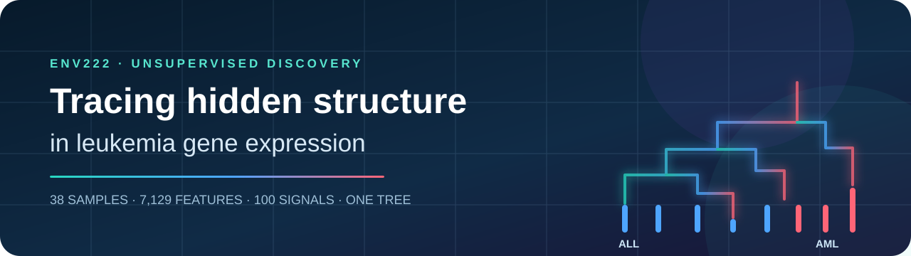
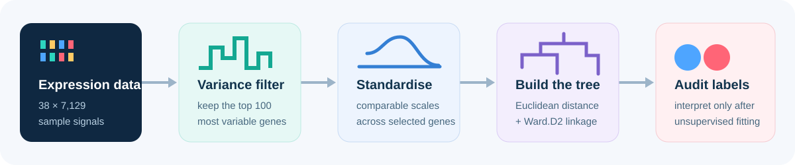
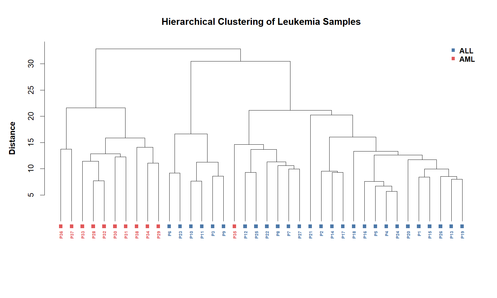
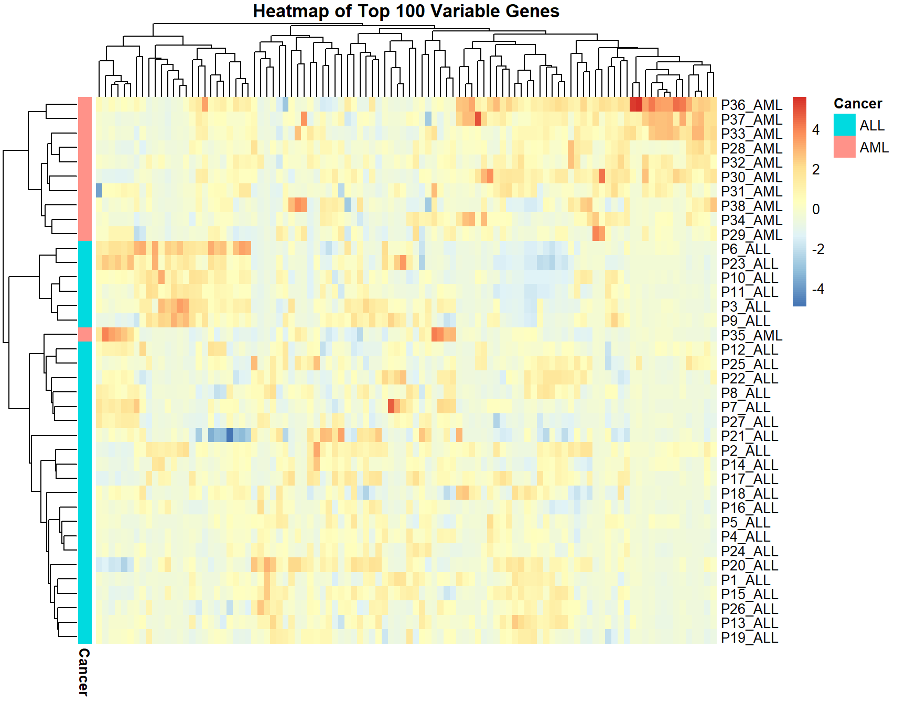

<div align="center">
  

  # Leukemia Gene Expression Clustering

  **Can an algorithm recover biological structure without being told the diagnosis?**

  [](https://www.r-project.org/)
  [](https://github.com/Ci-yo/ENV222-Leukemia-Clustering/actions/workflows/reproducibility.yml)
  
  
  
</div>

> [!IMPORTANT]
> This is an exploratory, educational analysis of a public gene-expression dataset. The clustering is not a diagnostic model and must not be used for clinical decisions.

## Step-by-step guide

### 1. Prepare your computer and get the files

Use [R](https://cran.r-project.org/) (R 4.4 or later recommended).
RStudio is optional. Check `Rscript --version` in your terminal. Install [Git](https://git-scm.com/downloads) to use the commands below.
Run them in a **terminal** (PowerShell on Windows; Terminal on macOS/Linux):

```bash
git clone https://github.com/Ci-yo/ENV222-Leukemia-Clustering.git
cd ENV222-Leukemia-Clustering
```

Alternatively, use **Code → Download ZIP**, extract it, and open a terminal in
the extracted folder. All commands below start in the folder containing
`README.md`. A second run replaces the generated outputs named below.

### 2. Install the heatmap package

```bash
Rscript requirements.R
```

The installer adds `pheatmap`. The included
[`data/leukemia_train_cleaned.csv`](data/leukemia_train_cleaned.csv) has 38 rows:
`patient`, `cancer` and 7,129 expression features. `cancer` is used only to
interpret the completed clustering, not to calculate the distance matrix.

### 3. Run the clustering

```bash
Rscript scripts/reproduce_analysis.R
```

The script selects the 100 highest-variance features, standardises them,
computes Euclidean distances and applies `ward.D2` linkage.
Expected final message:

```text
Analysis complete: 37 of 38 samples align with cluster majority labels.
```

For a table-only run that does not need `pheatmap`, use
`Rscript scripts/reproduce_analysis.R --check-only`. This option **still
writes result tables**; it skips figure generation.

### 4. Inspect the results and validate

| Output | Meaning |
|---|---|
| [`results/cluster_composition.csv`](results/cluster_composition.csv) | Cluster 1: 27 ALL + 1 AML; cluster 2: 0 ALL + 10 AML. |
| [`results/analysis_summary.csv`](results/analysis_summary.csv) | Input dimensions, selected genes, distance/linkage and post-hoc agreement. |
| [`results/top_variable_genes.csv`](results/top_variable_genes.csv) | The 100 selected features and their variances. |
| [`figures/leukemia-dendrogram.png`](figures/leukemia-dendrogram.png) | Sample relationships with labels added for interpretation. |
| [`figures/leukemia-heatmap.png`](figures/leukemia-heatmap.png) | Standardised expression patterns. |

```bash
Rscript scripts/validate_repository.R
```

The 37/38 agreement is descriptive concordance after clustering, not
held-out predictive accuracy.

### 5. Troubleshooting

| Symptom | Action |
|---|---|
| `Rscript` is not recognised | Add the R installation's `bin` folder to PATH, then open a new terminal. |
| An input file cannot be found | Return to the repository root; keep the checked-in folder structure. |
| The heatmap is unchanged but tables were written | Install `pheatmap` with `Rscript requirements.R`, then rerun without `--check-only`. |
| You want to cluster a different dataset | Adapt the schema and the explicit 38-row/7,131-column checks first; the script and validator target this archived dataset. |

## The project in 30 seconds

| The question | The experiment | The signal | The caution |
|---|---|---|---|
| Do leukemia samples form meaningful groups from expression profiles alone? | Standardise the 100 most variable genes, calculate Euclidean distances, then apply Ward's agglomerative clustering. | Two major branches broadly recover the ALL/AML structure: 37 of 38 samples align with their known label after the clusters are interpreted. | Labels were inspected only after clustering. This is concordance in one small dataset, not classification accuracy or clinical validation. |

## From 7,129 signals to one tree



The full matrix contains 38 samples and 7,129 expression features. Selecting the 100 most variable genes reduces noise for this visual exploration while retaining the strongest between-sample variation.

```r
top_genes <- names(sort(apply(expr_mat, 2, var), decreasing = TRUE))[1:100]
expr_scaled <- scale(expr_mat[, top_genes])
hc_samples <- hclust(dist(expr_scaled), method = "ward.D2")
```

## What the tree revealed



The dendrogram is built without ALL/AML labels. Colours are added afterwards as an interpretation layer. Cutting the tree into two clusters gives:

| Cluster | ALL | AML | Majority interpretation |
|---:|---:|---:|---|
| 1 | 27 | 1 | ALL-like |
| 2 | 0 | 10 | AML-like |

One AML sample sits inside the ALL-dominated branch. That exception is scientifically useful: it is a reminder that unsupervised structure is informative without being a perfect diagnostic boundary.

## The same structure, seen as expression patterns



The heatmap exposes blocks of relatively high and low standardised expression. Samples that share similar patterns sit close together in the row dendrogram, while the annotation strip reveals how those unsupervised groups relate to the known leukemia types.

## Why Ward's method?

Ward's linkage merges the pair of clusters that introduces the smallest increase in within-cluster variation. It tends to create compact groups and works naturally with Euclidean distance after feature scaling.

The choice is still an analytical assumption. Different gene-selection rules, distance measures, linkage strategies or sample cohorts may produce a different tree; see [METHODS.md](METHODS.md) for the audit trail and limitations.

## Explore the project

- [Listen to the final audio walkthrough](presentation/audio-walkthrough.mp3)
- [Open the compact Quarto walkthrough](presentation/project-walkthrough.qmd)
- [Inspect the complete R analysis](scripts/reproduce_analysis.R)
- [Review the tidy result tables](results/)
- [Read the data provenance note](data/README.md)

## Repository map

```text
.
├── data/            # Cleaned 38 × 7,131 sample table and provenance
├── figures/         # Project banner, workflow, dendrogram and heatmap
├── presentation/    # Compact walkthrough and final audio narration
├── results/         # Cluster composition, concordance and top genes
├── scripts/         # Reproducible R analysis and repository checks
├── METHODS.md       # Decisions, assumptions and limitations
└── README.md        # The project story
```

## Data and attribution

The analysis uses the training portion of the Golub leukemia gene-expression dataset, originally associated with Golub *et al.* (1999), *Molecular classification of cancer: class discovery and class prediction by gene expression monitoring*. The cleaned table was prepared from the public dataset distribution linked in [data/README.md](data/README.md).

---

<div align="center">
  <sub>A small unsupervised experiment about what a molecular profile can reveal—and what it cannot prove.</sub>
</div>
